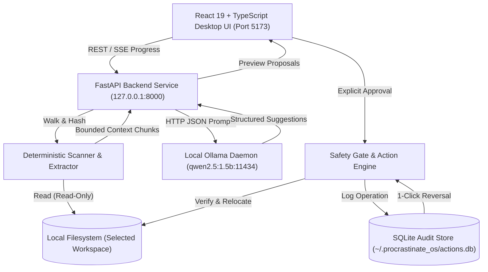
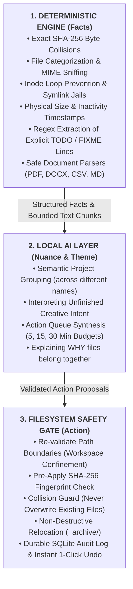
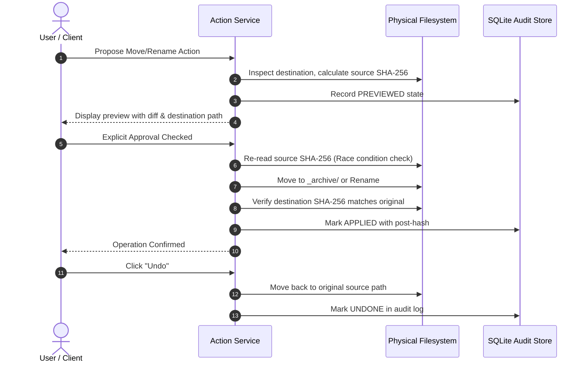

# ProcrastinateOS

<div align="center">

**Stop postponing. Let your computer do the boring work.**

*A 100% local-first, privacy-preserving desktop productivity system that recovers forgotten work, detects duplicate files, and turns digital clutter into actionable time-budgeted task queues.*

[](https://python.org)
[](https://fastapi.tiangolo.com)
[](https://react.dev)
[](https://www.typescriptlang.org)
[](https://ollama.com)
[](LICENSE)
[](tests/)

</div>

---

## Table of Contents

- [The Problem](#the-problem)
- [The Solution](#the-solution)
- [System Architecture](#system-architecture)
- [Key Capabilities & The 7 Views](#key-capabilities--the-7-views)
- [Safe Document Extraction Matrix](#safe-document-extraction-matrix)
- [Filesystem Action Safety Lifecycle](#filesystem-action-safety-lifecycle)
- [Installation & Setup](#installation--setup)
- [Using the Application](#using-the-application)
- [Automated Demo Walkthrough](#automated-demo-walkthrough)
- [Security & Threat Model](#security--threat-model)
- [Quality Assurance & Verification](#quality-assurance--verification)
- [Known Limitations & Roadmap](#known-limitations--roadmap)
- [Licensing & Third-Party Disclosures](#licensing--third-party-disclosures)

---

## The Problem

Every developer, writer, and researcher has folders cluttered with:
- Multiple revisions of the same project spec (`proposal_final_v2_really_final.docx`).
- Exact byte-for-byte duplicate downloads and dataset exports scattered across directories.
- Urgent `TODO:` and `FIXME:` reminders jotted down months ago inside forgotten project notes.
- Multi-gigabyte database dumps and raw binaries silently consuming solid-state drive capacity.

When we consider cleaning up, **decision fatigue** takes over. Evaluating 400 messy files requires 400 separate cognitive choices: *"What was this for? Who modified it last? Is it safe to delete?"* We postpone the chore, and our disks continue to degrade into digital landfills.

Traditional cloud "AI productivity" tools introduce severe security risks:
1. They require uploading personal directories and client files to remote corporate servers.
2. They demand recurring monthly subscriptions and metered API token charges.
3. They introduce the risk that sensitive personal journals, tax returns, or proprietary IP will be ingested into cloud training sets.

---

## The Solution

**ProcrastinateOS fixes this by running 100% locally on your computer.**

It pairs deterministic file analysis algorithms with an on-device local large language model (**Alibaba Qwen 2.5:1.5B via Ollama**) to organize messy folders, detect exact duplicate downloads, recover forgotten project notes, and generate a bite-sized **5, 15, or 30-minute action queue**.

- **Zero Cloud API Calls**: Every analysis and inference happens in local RAM.
- **Zero Telemetry**: No tracking, phone-home metrics, or external network requests.
- **Zero Subscription Fees**: Completely free and open-source under the MIT license.
- **Deterministic First**: Math handles hashes and sizes; AI handles semantic grouping and nuance.
- **Zero Destructive Deletes**: Supported actions only move files into workspace-contained `_archive/` folders or perform non-destructive renames, backed by a 1-click SQLite undo manifest.

---

## System Architecture



### Deterministic Engine vs. Local AI Layer

The cardinal architectural rule of ProcrastinateOS is: **never ask an LLM to perform tasks that mathematical algorithms solve with certainty.**



If Ollama is stopped or unavailable, **ProcrastinateOS degrades gracefully**: duplicate detection, large file analysis, format extraction, and TODO harvesting continue working at 100%.

---

## Key Capabilities & The 7 Views

The user interface is designed with a restrained desktop productivity aesthetic (warm off-white surfaces `#FBFBF9` and deep forest-green `#193820` accents), avoiding neon glows or stock graphics.

### 1. Workspace
- Native folder picker (`showDirectoryPicker()`) with manual path fallback.
- Configurable recursion depth limits, file count caps, and traversal timeouts.
- Real-time Server-Sent Events (SSE) progress bar with item counts and skipped file diagnostics.

### 2. Overview
- Telemetry across Documents, Code, Media, Archives, and Data.
- Recoverable storage estimates based on cryptographic byte matches.
- Extremes inventory pinpointing oldest, newest, and largest files across the directory.
- Live Ollama connection health and latency indicators.

### 3. Forgotten Work Recovery
- **Semantic Project Grouping**: Clusters related files based on topic and content, even when filenames are completely different. Every group cites real, verified file IDs.
- **Explicit Marker Extraction**: Detects `TODO:`, `FIXME:`, `WIP:`, and unresolved questions directly from document text.
- **Honest Uncertainty**: Clearly separates measured filesystem facts from inferred possibilities with confidence indicators.

### 4. Procrastination Action Queue
- **Time-Budgeted Triage**: Choose **5, 15, or 30 minutes** to receive a bounded set of manageable micro-tasks.
- **Evidence-Backed**: Every action cites specific files, explains the reasoning, and provides an approximate effort estimate.
- **Interactive State Transitions**: Transition tasks between Proposed, Approved, Completed, Dismissed, and Blocked.

### 5. Clutter & Duplicates
- **Exact Duplicates**: Two-pass duplicate finder (O(1) size grouping + SHA-256 chunk streaming) reporting exact recoverable bytes.
- **Redundant Exports**: Identifies compiled artifacts (`dist/`, `build/`, `*.pdf`) paired with master editable sources (`*.docx`, `*.md`).
- **Storage Offenders**: Identifies inactive files exceeding configurable size thresholds.

### 6. Activity History & Durable Audit
- **SQLite Audit Manifest**: Every move and rename is persisted in `~/.procrastinate_os/actions.db`.
- **Pre & Post Verification**: SHA-256 hashes recorded before and after operations.
- **1-Click Undo**: Instantly revert any applied operation back to its original path.

### 7. Settings & Local Model Control
- **Ollama Management**: Configurable model name (`qwen2.5:1.5b` default), real-time connection status check, and offline recovery guides.
- **Scan Presets**: Adjust depth limits, file size filters, and document extraction toggles.
- **Supported Format Specifications**: Live capability listing for PDF, DOCX, Markdown, Text, CSV, and JSON.

---

## Safe Document Extraction Matrix

Before an AI can organize files, it must read them. ProcrastinateOS implements safe, bounded text extractors without running third-party binary executables:

| File Format | Extraction Engine | Extraction Limits | Safety Guards |
| :--- | :--- | :--- | :--- |
| **Markdown (`.md`)** | Python Standard Library | Max 100 KB text, 10 chunks | Strips HTML script tags, extracts explicit TODO markers |
| **Plain Text (`.txt`)** | Python Standard Library | Max 100 KB text, 10 chunks | Encoding fallback (UTF-8 $\to$ Latin-1), null byte sanitization |
| **PDF (`.pdf`)** | PyMuPDF (`fitz`) | Max 25 pages, 150 KB text | Text-only stream extraction, zero JavaScript execution, password trap catcher |
| **Word (`.docx`)** | `python-docx` | Max 300 paragraphs, 150 KB | XML parser entity expansion disabled, macros/VBA completely ignored |
| **CSV (`.csv`)** | Python `csv` reader | Max 100 rows, 50 KB text | Cell formula prefix injection neutralization (`=`, `@`, `+`, `-`) |
| **JSON (`.json`)** | Python `json` parser | Max 100 KB, bounded depth | Recursion limit guard, key-value structural summaries |

---

## Filesystem Action Safety Lifecycle

When software touches a user's disk, trust is paramount. ProcrastinateOS enforces a strict 6-stage lifecycle for all filesystem operations:

$$\text{PROPOSE} \longrightarrow \text{PREVIEW} \longrightarrow \text{APPROVE} \longrightarrow \text{APPLY} \longrightarrow \text{VERIFY} \longrightarrow \text{UNDO}$$



### Safety Rules Built Into the Engine
1. **Zero Permanent Deletes**: The backend contains no `rm` or `unlink` endpoints. Files are only relocated to `_archive/` or renamed.
2. **Symlink Confinement**: Symbolic links pointing outside the workspace (e.g. `symlink -> ~/.ssh`) are rejected via `os.path.realpath`.
3. **Pre-Apply SHA-256 Check**: If a file was modified by an external process between preview and approval, the action aborts immediately.
4. **Collision Guard**: Relocating to a destination where a file with the same name already exists is automatically blocked (`can_apply = False`).
5. **DNS Rebinding Guard**: The server binds to `127.0.0.1` and validates `Host` headers to prevent malicious websites from executing cross-origin local requests.

---

## Installation & Setup

### Prerequisites
- macOS (Apple Silicon or Intel) or Linux
- Python 3.10+ (Python 3.11 recommended)
- Node.js 18+ and npm
- [Ollama](https://ollama.com) (free, open-source local inference runtime)

### 1. Start Ollama and Pull Model
```bash
# Start Ollama service (if not already running)
ollama serve

# In a separate terminal, pull the default lightweight model (under 1.5 GB RAM)
ollama pull qwen2.5:1.5b
```

### 2. Setup and Start Backend
```bash
cd backend

# Create virtual environment
python3.11 -m venv venv
source venv/bin/activate

# Install dependencies
pip install -r requirements.txt

# Start backend server on 127.0.0.1:8000
uvicorn app.main:app --host 127.0.0.1 --port 8000 --reload
```

### 3. Setup and Start Frontend
```bash
cd frontend

# Install Node dependencies
npm install

# Start development server on localhost:5173
npm run dev
```

Open **`http://localhost:5173`** in your browser.

---

## Using the Application

1. **Pick Workspace**:
   - In the **Workspace** tab, select or paste any local folder (e.g., `./demo_workspace`).
   - Click **Start Workspace Scan**.
2. **Review Metrics & Findings**:
   - Check the **Overview** view for file counts, extracted formats, and recoverable bytes.
   - Check **Clutter & Duplicates** to inspect exact SHA-256 duplicate matches.
3. **Run Semantic Grouping**:
   - Switch to **Forgotten Work**.
   - Click **Run Local AI Grouping**. The local Ollama model clusters scattered files into cohesive projects without transmitting data over the internet.
4. **Take Action in the Queue**:
   - Switch to **Action Queue**.
   - Select a time budget (**5 min**, **15 min**, or **30 min**).
   - Click **Generate Queue**.
5. **Preview, Approve, and Undo**:
   - Click **Preview** on any proposed item.
   - Review destination and validation checks.
   - Click **Approve & Apply** to relocate the file into `_archive/`.
   - To reverse, open **Activity History** and click **Undo Action** to restore the file instantly.

---

## Automated Demo Walkthrough

We provide an end-to-end automated demo script that runs all 10 workflow steps against a synthetic workspace containing zero private data:

```bash
# Run the complete automated demo walkthrough
./backend/venv/bin/python scripts/demo_walkthrough.py
```

```text
======================================================================
  ProcrastinateOS: End-to-End Local System Demo Walkthrough
  'Stop postponing. Let your computer do the boring work.'
======================================================================

[Step 1/10] Checking System & Local Model Health...
  • API Status: OK (Ollama Connected: True, Model Present: True)
[Step 2/10] Scanning Workspace: demo_workspace...
  • Total Scanned Files: 11 (2.5 MB) in 0.013s
[Step 3/10] Inspecting Safe Document Extractions...
  • Total Documents Extracted: 10
[Step 4/10] Reviewing Deterministic File Findings...
  • Total Deterministic Findings: 4 (Potential Recoverable: 4.2 KB)
[Step 5/10] Running Local AI Semantic Project Grouping...
  • Discovered Project Clusters: 1 ('Project Apollo')
[Step 6/10] Generating Bounded Procrastination Action Queue (15-Minute Budget)...
  • 3 micro-tasks scheduled (13 min total)
[Step 7/10] Filesystem Action Workflow: Proposing & Previewing Archive...
  • Previews validated successfully
[Step 8/10] Simulating Explicit User Approval & Applying Action...
  • File relocated to _archive/
[Step 9/10] Invoking 1-Click Action Undo...
  • Original file restored, archive stub removed.
[Step 10/10] Querying Persistent SQLite Audit Manifest...
  • Durable audit record verified.

======================================================================
  DEMO WALKTHROUGH COMPLETED SUCCESSFULLY WITH 100% PASSING STEPS!
======================================================================
```

---

## Security & Threat Model

ProcrastinateOS operates on untrusted user files and must defend against local threat vectors. See [SECURITY.md](SECURITY.md) for full details.

### Security Defenses
- **Local Loopback Isolation**: FastAPI binds strictly to `127.0.0.1` (never `0.0.0.0`).
- **DNS Rebinding Protection**: Validates HTTP `Host` headers (`localhost`, `127.0.0.1`).
- **Prompt Injection Containment**: All extracted document text is scrubbed of delimiter tokens and wrapped in `<untrusted_document_context file_id="...">` XML tags. The LLM has zero tool execution privileges.
- **Path Traversal Guards**: All paths are resolved to their real paths (`os.path.realpath`) and verified to reside inside the approved workspace root before any read or move operation.

---

## Quality Assurance & Verification

Every component in ProcrastinateOS is verified by automated test suites:

- **Backend Pytest Suite (77 Tests)**:
  ```bash
  ./backend/venv/bin/pytest backend/tests tests/integration
  # 77 passed in 28.5s
  ```
- **Type Checking (0 Errors, 0 Warnings)**:
  ```bash
  npx pyright backend scripts tests
  # 0 errors, 0 warnings across all files
  ```
- **Frontend Vitest Suite (24 Tests)**:
  ```bash
  npm --prefix frontend test -- --run
  # 24 passed in 1.5s
  ```
- **Production Build (Vite + TypeScript)**:
  ```bash
  npm --prefix frontend run build
  # Built cleanly in 250ms
  ```

---

## Known Limitations & Roadmap

We believe in honest open-source disclosure. The initial v0.1.0 release has the following limitations:

1. **No OCR for Scanned Image PDFs**: Scanned image-only PDFs without text streams are detected and flagged as unextractable. Lightweight Tesseract and Apple Vision OCR extractors are scheduled for v0.2.0.
2. **Context Window Limits on Small Models**: The default `qwen2.5:1.5b` model uses a bounded 4,000-token context window for low latency. Workspaces with thousands of files are batched.
3. **No Network Shared Drives**: The current action engine is tested against local solid-state drives and filesystems (APFS, ext4, NTFS). Network mounted SMB/NFS drives are not yet certified.

---

## Licensing & Third-Party Disclosures

- **Application Code**: Licensed under the [MIT License](LICENSE). Copyright (c) 2026 ProcrastinateOS Contributors.
- **Default Language Model**: Alibaba Qwen 2.5 (`qwen2.5:1.5b`) is licensed under the Alibaba Qwen License / Apache 2.0. Model weights are downloaded and executed separately by the user via Ollama.
- **Third-Party Dependencies**: All dependencies (FastAPI, PyMuPDF, python-docx, React, Lucide) remain under their respective permissive open-source licenses (MIT, Apache 2.0, BSD, AGPL/commercial PyMuPDF dual license).
