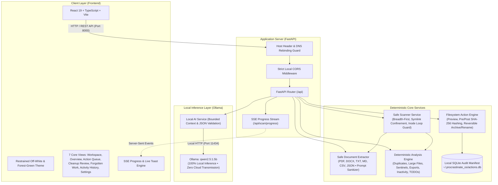
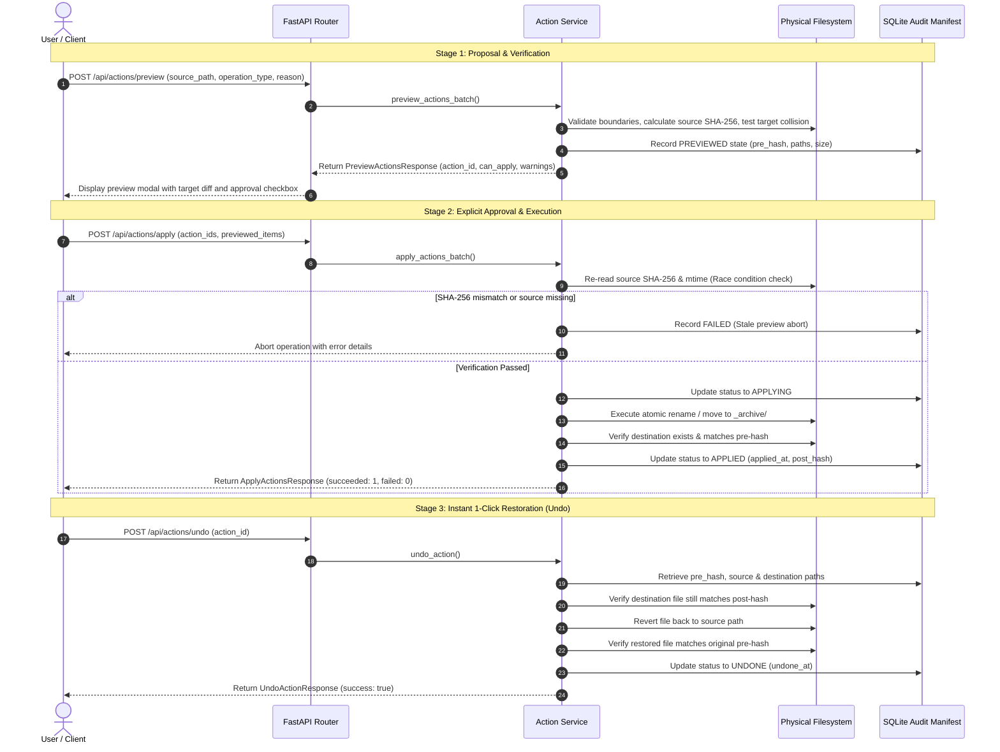

# ProcrastinateOS: System Architecture & Technical Specifications

> *"Stop postponing. Let your computer do the boring work."*

ProcrastinateOS is engineered as a local-first, privacy-preserving desktop productivity tool. It combines deterministic file analysis algorithms with bounded on-device local large language model (LLM) inference to surface forgotten creative and engineering work, detect duplicate files, and turn digital clutter into manageable, time-budgeted action queues.

---

## 1. System Architecture Diagram

---

## 2. End-to-End Action Lifecycle Diagram

The application enforces a strict 6-stage lifecycle for all filesystem operations to eliminate accidental data loss, unexpected overwrites, or model hallucinations.

---

## 3. Component Details & Responsibilities

### A. Safe Scanner Service (`scanner_service.py`)
* **Bounded Traversal**: Breadth-first directory queue respecting configurable limits (`max_depth: 15`, `max_files: 50,000`, `timeout: 60s`).
* **Symlink Confinement**: Rejects symlinks that resolve outside the validated workspace directory.
* **Inode Loop Prevention**: Tracks `(st_dev, st_ino)` pairs to prevent infinite cycles from cyclic filesystem structures.
* **Diagnostic Reporting**: Logs inaccessible directories and oversized files as `SkippedFile` records without crashing traversal.

### B. Safe Document Extractor (`document_extractor.py`)
* **Supported Formats**: `.txt`, `.md`, `.markdown`, `.pdf`, `.docx`, `.csv`, `.tsv`, `.json`.
* **Bounded Output**: Enforces character caps (`max_chars: 60,000`) and chunk counts (`max_chunks: 50`) per file to protect local LLM context windows.
* **Prompt Injection Neutralization**: Strips special delimiter tokens (such as `<|im_start|>`, `<|im_end|>`) and encapsulates text inside `<untrusted_document_context>` XML wrappers.
* **Non-Executable Handling**: Never executes macros, embedded scripts, or dynamic document payload attachments.

### C. Deterministic File Analysis Engine (`analysis_engine.py`)
1. **Exact Duplicates**: Byte-level SHA-256 checksum comparison.
2. **Large Files**: Configurable threshold (default 2 MB or 200 MB) with measured facts vs inferred possibilities.
3. **Empty Files**: Distinguishes intentional repository sentinels (`.gitkeep`, `__init__.py`) from accidental stubs.
4. **Redundant Exports**: Identifies compiled artifacts (`dist/`, `build/`, `*.pdf`) co-existing with master editable sources (`*.docx`, `*.md`).
5. **Old File Review**: Surfaces long-inactive files with non-pejorative framing (inactive files are not automatically treated as garbage).
6. **Explicit TODOs**: Scans document text for explicit author markers (`TODO:`, `FIXME:`, `WIP:`, `INCOMPLETE`) with page or line references.

### D. Local AI Service (`local_ai_service.py`)
* **Target Model**: `qwen2.5:1.5b` running on local Ollama instance (`http://localhost:11434`).
* **Semantic Project Grouping**: Clusters related files based on topic and semantic affinity; strictly validates that file IDs cited by the model actually exist on disk.
* **Action Queue Synthesis**: Produces prioritized tasks bounded by selected time budgets (5, 15, or 30 minutes).
* **Deterministic Fallback**: If Ollama is offline or returns invalid JSON, the service immediately generates deterministic action recommendations, ensuring 100% application uptime.

### E. Filesystem Action Engine & Audit Store (`action_service.py`, `action_store.py`)
* **Reversible Move & Rename**: Supports moving items into a workspace-confined `_archive/` folder or renaming files to approved patterns. Permanent file deletion is explicitly forbidden.
* **Atomic Pre-Verification**: Confirms file existence, size, and SHA-256 immediately before applying changes.
* **Durable SQLite Manifest**: Records all actions in `~/.procrastinate_os/actions.db` with pre/post hashes, execution timestamps, and interruption recovery.
